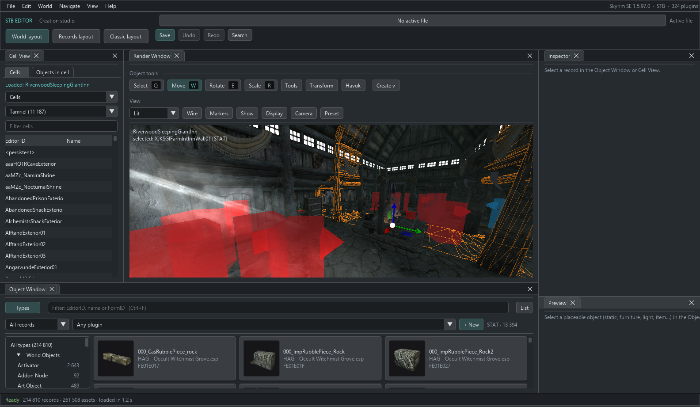
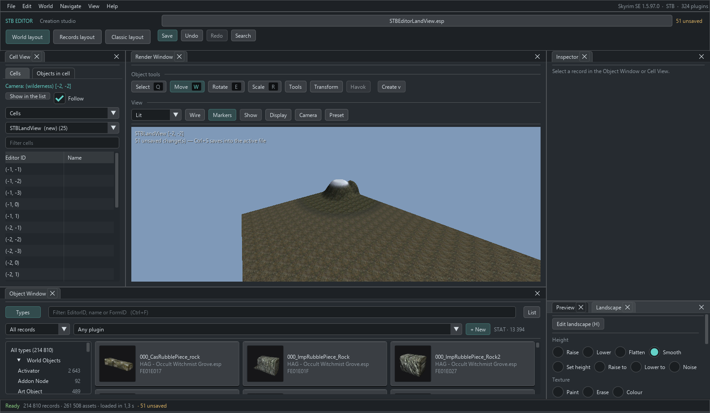
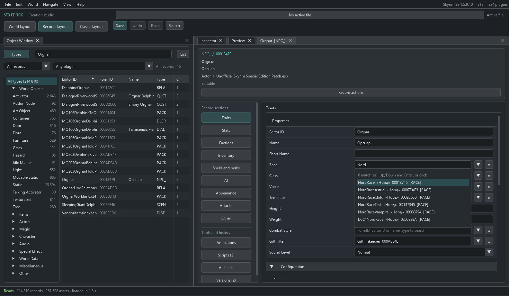
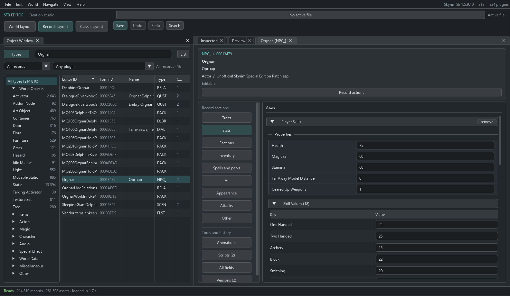
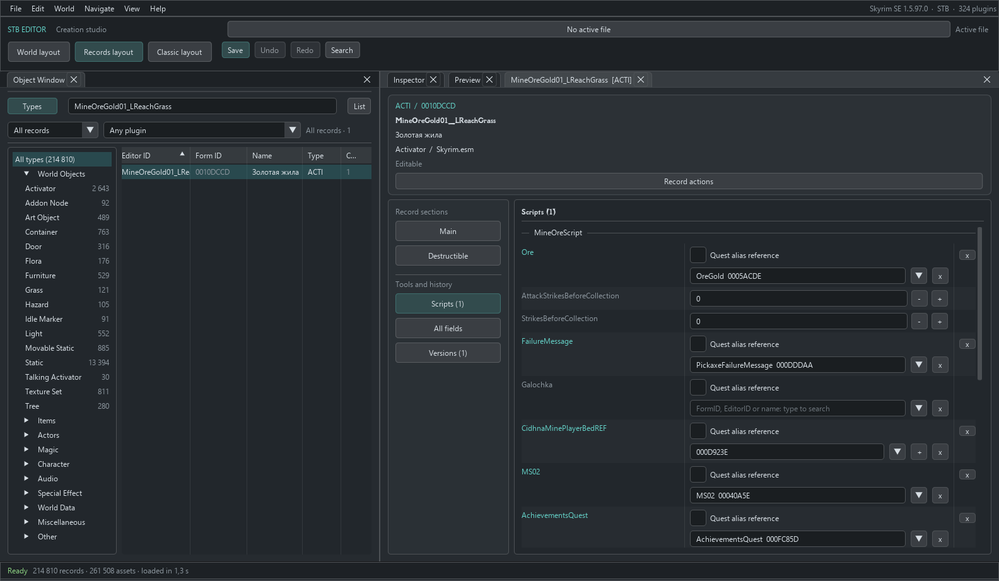
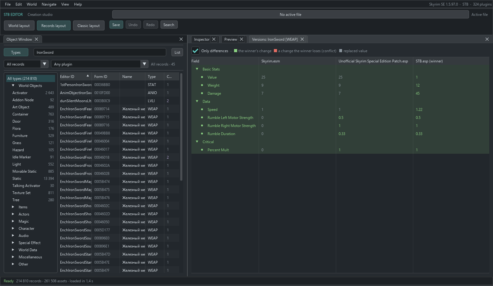
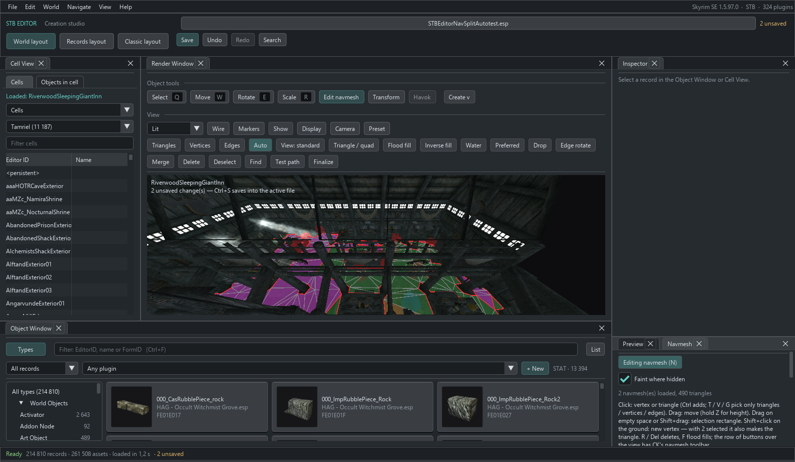

# STB Editor

A standalone Skyrim SE / AE / VR editor for object placement, cells and worldspaces, landscape,
navmesh, record fields, quests and dialogue, and Papyrus scripts with compilation.
Supports ESP / ESM / ESL plugins and header versions 1.70 and 1.71 (including SE with BEES).

Launching through MO2 is optional: the editor reads its profile directly and saves plugins into mod folders.

- [Developer guide](docs/DEVELOPING.md): building, architecture, checks and adding features.
- [Rendering guide](docs/RENDERING.md): shaders, effects, particles and approximations.
- [AI / MCP guide](docs/AI-BRIDGE.md): optional access to the live editor session.
- [Agent instructions](AGENTS.md).

## Current capabilities

Current code: 0.76.0 + **Unreleased** (workspace shell, alias scripts, collision fixes and AI/MCP).
These are implemented capabilities, not a claim that all game data has been exhaustively tested or
that every Creation Kit or xEdit operation has an equivalent.

| Area | Available behavior |
|---|---|
| Data and interface | MO2 / Data load orders, game-consistent indices, BSA and loose assets, record catalog, Object Window, Cell View and its object list, Inspector, Load Order, English and Russian UI, F1 help |
| 3D view | NIF models, interiors, exteriors with landscape and water, cell and point lighting, click selection, CK-style camera, exterior streaming, particles and animated effects, NPCs and creatures with outfits and FaceGen in bind pose |
| Placement | Active-file saving, undo/redo, 3D thumbnails, reference flags, enable parent, ownership, locks, teleport and linked references |
| Records | Forms and fields, creation and duplication, comparison, Use Info, conditions, scripts and properties, quests, dialogue, scenes, AI packages, Papyrus and fragment compilation; alias scripts are Unreleased |
| World editing | New cells and worldspaces, existing header properties, height and texture brushes, vertex colors, heightmaps and region boundaries |
| Navmesh | Display, selection, movement, deletion, triangle creation, flags, Finalize (doors, links and NAVI), per-cell generation |

**AI / MCP:** a compatible HTTP MCP client can access the open, unsaved session: screenshots, camera,
FormKeys, structured edits with undo, and proposals requiring a user decision. The bridge is off by
default; direct edits and **UNSANDBOXED C# scripts** have separate permissions. External script effects
are not undoable. This is a ready-made local interface, not a model-exclusive capability: a coding agent
with a shell and source access can build alternative IPC or a harness. Claude Code is only an optional,
collapsed launcher in the AI / MCP window, not a requirement for other clients. See the
[connection and security guide](docs/AI-BRIDGE.md).

### Current limitations

- No deep-copy or record transfer between plugins, localized `.strings` writing, or quest
  stage/objective export. JSON translation export/import is available.
- No navmesh cover-edge generation, Balance for Optimization, or negative generation volumes.
  Generation needs manual cleanup; it does not replace all existing navmeshes in a cell.
- No Join/Break Occlusion Planes, water-current primitives, Water Flow brushes or isometric view.
  Regions support boundaries and fields, not object/grass generation.
- Weather preview covers lighting, fog and sky color, not clouds, precipitation or image-space effects.
  Actors are in bind pose; see [rendering limitations](docs/RENDERING.md). Physics uses Bepu and is
  not a full Havok simulation. Idle editing does not suggest events from `.hkx` graphs.
- No general NIF editor, SKSE live-link or built-in LOD/local-map generator. Use external LOD tools
  such as xLODGen, TexGen and DynDOLOD; Skyrim renders its local map itself.
- Framework inspection covers SPID, KID, BOS, FLM, DESC, SRD, OAR and DAR, not IED or SkyPatcher/CDF.
- MCP has no dedicated plugin/navmesh-check tools or proposals for arbitrary field edits.

## Download

Get `STBEditor-<version>.zip` from [Releases](https://github.com/STB-Team/STB-Editor/releases/latest),
extract it anywhere (for example `<game>\STB Editor\`) and run `STBEditor.exe`.
No separate .NET installation is required. You may register it as an MO2 executable, but the editor
can read the MO2 profile without being launched through MO2.

## Build and run

Requires .NET SDK 10.

```powershell
dotnet build STB-Editor.sln -c Release
src\Editor.App\bin\Release\net10.0-windows\win-x64\STBEditor.exe
```

Portable archive: `package.ps1` → `dist\STBEditor-<version>.zip`. Extract anywhere; optionally add
`STBEditor.exe` to MO2 as an executable, like Creation Kit.

Options: `--game <game folder>`, `--mo2 <folder|none>`, `--profile <name>`, `--open` (skip the dialog),
`--search <text>`, `--select <FormID>`, `--cell <EditorID|FormID>`,
`--screenshot <file.bmp>` (capture after loading, then exit).
See [DEVELOPING.md](docs/DEVELOPING.md) for diagnostic options.

Settings, catalog cache, logs and backups live in `%LOCALAPPDATA%\STBEditor`.

## Interface

Screenshots show the current Unreleased UI with English controls and the STB mod profile.
Record names retain the installed game's language; assets and appearance depend on the installation.



- The top workspace bar provides **World**, **Records** and **Classic** layouts, saving, undo/redo,
  search and active-file selection. World places the catalog below the scene; Records gives it
  38% of the width, with Inspector and Preview as neighboring tabs on the right. Forms and comparisons
  open there too ([example](docs/images/editor-records.png)), and can still be detached.
  Changing layout does not close records, clear selection or change edit history. Existing custom
  layouts are preserved at startup; select a new layout explicitly. The same commands are under
  **View → Layout**. The main font is Segoe UI; game-style headings remain.
- Record forms have a header showing type, FormID, source and state. **Record actions** contains
  Use Info, duplication, deletion and other operations. Wide forms have a section list on the left;
  narrow Inspectors use **Sections**. Specialized editors and **All fields** remain accessible.
  Buttons, tabs and cards have distinct surfaces and edges in every theme, not just STB.
  A narrow or short viewport (including at 200% scaling) collapses toolbar commands into **Tools**
  and **Display**, rather than removing them. Forms and comparisons have readable minimum sizes,
  including after loading old layouts. Window/tab close targets are 24 px at 100%; selected buttons
  have continuous borders. Short forms reduce their header; the EditorID tooltip retains name and source.
- **Quest → Aliases → selected alias → Alias scripts** attaches/removes scripts, opens source,
  auto-fills and edits properties, including arrays and quest-alias references. The quest's own scripts
  are in **Scripts**, which also shows the number of alias scripts.
- **File → Data** selects the game, MO2 profile and plugins: load everything or only checked plugins,
  with required masters included automatically. FormID indices remain game-consistent.
- **View → Language** switches immediately between English and Russian.
- **View → Settings** controls wheel/fly speed, door confirmation, NPC highlighting, FPS, language,
  15 color themes, UI size (75–200%; Ctrl+= / Ctrl+- / Ctrl+0), and record header fields (hidden by default).
- **Help → Keys and features** (F1) lists keys and workflows.
- **View** controls open windows (Log and Load Order start closed), FPS limits (60 foreground,
  15 background by default), and resetting the layout.
- **Cell View** shows cells and their objects side by side when wide, or in **Cells / Cell objects**
  tabs when narrow. Exterior objects belong to the central or selected cell. Clicking selects an
  object and focuses the camera. Filter by EditorID, type or FormID; enable extra columns through
  the table-header context menu.
- On slower PCs, adjust **Display → Particles / Animations** and **Camera → Cell loading radius**.
  Camera is inside Display in narrow windows. Meshes and textures not seen for a while are evicted
  when they exceed their share of video memory.

## Render Window controls

Camera (CK-style, plus flight):

| Action | Control |
|---|---|
| Load cell | Double-click in Cell View |
| Create primitive (CK main-toolbar equivalents) | Render Window → Create: trigger, multibound, occlusion, room and portal (with links), collision, acoustic and sound markers; around selection or where the view points |
| Reference window | Double-click an object: 3D data with step arrows, CK flags by object type, enable parent, ownership, lock, teleport, linked references, Linked From, scripts and other tabs; Edit base |
| Go through a door | Double-click door → Go through door in the reference window, or Inspector → Teleport → Go to linked door; loads the destination cell at its arrival marker |
| Orbit selection (look around if none) | Shift + mouse |
| Pan | Space + mouse or MMB |
| Zoom | Smooth wheel; Shift faster, Ctrl slower; speed in View → Settings |
| Fly | RMB on empty space + WASD, Q/E down/up; wheel while holding RMB changes speed |
| Orbit | Alt + LMB |
| Focus selection / top view | C or double-click / T |
| Selection see-through → hidden → shown / show all | 1 / Alt+1 |
| View preset (visibility, lighting, speed, grid radius) | Preset; in narrow windows, Display → Preset |
| Camera location / find placements throughout the world | Cells: Camera row and Find placed objects |

Objects:

| Action | Control |
|---|---|
| Select | LMB; Ctrl+LMB adds/removes |
| Move on ground | LMB-drag selection; hold Z for height, X / Y for one axis |
| Rotate | RMB-drag selection around Z; hold X / Y for other axes |
| Scale | S + LMB-drag |
| Gizmo | Q select, W move (arrows), E rotate (rings), R scale; L world/local axes |
| Snap | G toggles grid; step, angle and world/local axes in Snapping |
| Drop to ground | F |
| Delete | Delete |
| Undo / redo | Ctrl+Z / Ctrl+Y; Edit → Undo names the operation |
| Exact values | Inspector → Placement: position, rotation in degrees, scale |
| Markers / cell borders / wireframe | M / B / Shift+W |
| Place object | Drag from Object Window (list or tiles) or Preview into Render Window |
| Duplicate | Ctrl+D; copy at the same position, selected and ready to drag |
| Object palette | World → Object palette: click to place a random member with randomized rotation and scale |
| Layers | World → Layers: reference groups, hide or freeze (visible but not selectable); stored outside the plugin |
| Story Manager | World → Story Manager: event, branch and quest-node tree; click opens a form |
| Export FaceGen | Object Window: Ctrl+F4 or NPC context menu → Export FaceGen; head and tint next to the active file |
| Face editor | NPC form → Appearance: head parts, presets, sliders, colors, tints and live head preview |
| Run Havok Sim | Alt+H or Havok (Tools → Havok when narrow); selected objects fall and settle, one Ctrl+Z |
| Generate navmesh | Navmesh panel → Generate navmesh: cell meshes and landscape, followed by Finalize |
| Perk tree | Skill (AVIF) form → Perk tree: drag nodes, Ctrl+click to link, double-click opens perk; As in the game uses the game's sky/star NIF and executable-derived placement, lets you take perks, check branches and drag stars over the constellation |
| Idle animations | World → Idle animations: graph/action tree, evaluation order, dragging and new idles |
| Plugin assets | File → Plugin assets: required files, sources and missing assets |
| Data export, ModGroups | File → Export data: text and GMST categories to TSV; ModGroups: plugin groups for conflict filtering |
| Scripts | File → Scripts: C# `.csx` scripts read/edit records; API edits form one Ctrl+Z; examples included. Scripts are UNSANDBOXED; external effects are not undoable |
| Regions | World → Regions: landscape boundaries, draggable corners, new regions and areas |
| Collision | Render Window → Display → Collision (F4): nearby objects' Havok collision |
| Weather and time | Exterior Render Window → Display → Sky: climate weather or any weather, hour 0–24; lighting, fog and sky color |
| SKSE frameworks | Use Info → Frameworks: SPID, KID, BOS, FLM, DESC, SRD, OAR, DAR; NPC Spells and perks / Animations tabs. Display → BOS preview shows Base Object Swapper replacements |
| Filtered dialogue | World → Filtered dialogue: what an NPC may say, using ID, voice, faction and other conditions |
| Voice files | World → Voice files: required files by voice type, existing files, list export, `.lip` via CK LipGenerator and `.fuz` |
| Copy / cut / paste | Ctrl+C / Ctrl+X / Ctrl+V at cursor; Ctrl+Shift+V at original position, including another cell. Copies keep reference properties except teleport |

The Render Window toolbar groups commands by task:
- **Select / Move / Rotate / Scale**, **Snapping**, **Havok**, **Create** edit objects.
- **Tools** selects navmesh, landscape, palette and regions; switching to landscape/navmesh opens
  its panel. Narrow windows also put Havok and Create here.
- Lighting mode, **Wireframe**, **Markers**, **Show** (CK-style type visibility, including **Current
  cell only**). Hidden objects cannot be selected; markers also show reference primitives.
- **Display** controls water, terrain, grass, fog, brightness, sky, collision, borders, navmesh, BOS,
  particles, animations and NPC highlighting. **Diagnostics** keeps rendering counters and can restore
  detailed text over the scene. **Camera** controls fly speed/loading radius; **Preset** offers built-in
  and saved views. Narrow toolbars put Camera and Preset in Display; buttons wrap to available width.

## Saving (CK-style)

- **File → Active File...** selects the destination plugin or creates one with a name and ESL/ESM
  flags; ESL is off by default. New plugins go to MO2 `overwrite` (otherwise `Data`). In MO2,
  right-click Overwrite → Create mod to turn it into a mod.
- **Ctrl+S** saves to the active file, asking for a destination first if none is selected.
- Before replacement, the editor writes a temporary file, verifies it by reading, and backs up to
  `%LOCALAPPDATA%\STBEditor\backups\<plugin>\`, retaining the last 30 backups.
- Untouched records in existing plugins remain **byte-for-byte identical**. A new required master
  shifts the plugin's own FormIDs and requires a full rewrite. **Save validation** requires confirmation
  of a new master **even without other losses**, and lists differing records (FormID renumbering does
  not count as a change). The target ESP is not replaced before confirmation. Review the list;
  **Save to new plugin** is an alternative.
- **File → Masters** shows unused masters and provides Add master, Remove unused and Sort Masters.
  Changes apply on Ctrl+S and can be undone with Ctrl+Z; saving rewrites with remapped FormIDs.
- Editing another plugin's reference creates an override. Deleting it safely disables it (initially
  disabled, enable parent = player, z = −30000); the active plugin's own reference is actually removed.

## New cells and worldspaces

- **World → New Interior Cell...**: Editor ID, name, lighting template or custom colors/fog.
  The cell opens immediately in Render Window, ready for placement.
- **World → New Worldspace...**: Editor ID, name, climate, water/type/height, default land height,
  small-world flag and number of cells around (0, 0).
- Placing an object where an exterior cell does not exist creates the cell automatically.
- New cells appear in Cell View as **new**. Ctrl+S writes them to the active file; Ctrl+Z undoes creation.

## Landscape (CK Landscape Edit)



- **H** or **Land** on the Render Window toolbar enables landscape mode. Settings are in
  **Landscape**, a tab next to Preview.
- Height brushes: **Raise / Lower** (Shift reverses), **Flatten** (stroke-start height), **Smooth**,
  **Set height** (CK Absolute Height), **Raise to / Lower to** (stop at the target), **Noise**.
  Enter target height or **Ctrl+click** terrain to sample it. Sliders control radius, **falloff**
  (CK Edit Falloff %; inner circle has full strength) and strength.
- Texture brushes: **Paint** (previewed texture list; **Max opacity** as in CK), **Erase**,
  **Grass off / Grass on**. Grass brushes exchange the visible texture for a twin with the same TXST
  and opposite grass state (for example LTundra01 / LTundra01NoGrass), preserving appearance.
  The list shows how many loaded quadrants use each texture and can show only used textures.
- LMB-drag terrain; one stroke is one Ctrl+Z. Adjacent cell edges are stitched.
- Painting a quadrant's base texture removes layers above it. Each quadrant supports up to six layers
  (game limit).
- **Color** paints vertex colors; white removes tint.
- **Create flat land** fills loaded cells without terrain at the chosen height, useful for new worlds.
- **Heightmap**: Export heightmap writes loaded cells to 16-bit `.r16` (north at top, usable with World
  Machine, Gaea and image editors) plus `.json`; Import heightmap brings edited data back into the same
  cells as one undo step.
- LAND stores heights in eight-unit steps, with at most 127 steps between neighboring points;
  steeper cliffs are clamped by the format.

## Reference properties, records and scripts (Inspector)

A reference selected in Render Window appears in Inspector:
- **Placement**: position, rotation in degrees, scale.
- **Reference**: Persistent, Initially disabled, Visible when distant and other flags; **Enable parent**
  with Opposite / Pop in; **Ownership** (NPC or faction/rank); **Lock** (level, key, leveled);
  **Teleport** (destination door and marker; **Link with a door...** lets you click another door,
  including in another cell, to link both directions and place arrival markers in front);
  **Linked references**, item count and light radius.
- **More properties** expands other reference fields: reference Editor ID, leveled-actor level,
  encounter zone, persistent location, location ref types, activate parents, map marker, emittance,
  lighting, NPC horse and merchant container, primitives, rooms, portals and more. Multi-selection
  applies edits to all selected references.
- **Scripts**: attached scripts and properties.

Reference fields: type an EditorID, name or FormID to see matching records of the required type;
use arrows and Enter or click. **▼** opens the full filtered list for that type, like CK dropdowns.
Drag a form from Object Window, or for placed references use **+** then click in Render Window
(Esc cancels). **x** clears the field.



### Record forms (CK-style)



Any record is editable immediately, without an edit-mode toggle, in Inspector or a **separate form
window**: double-click in Object Window or use **In window**. Multiple forms can remain open.

- CK-style actor sections: Traits, Stats, Factions, Inventory, Spells and perks, AI, Appearance, Attacks.
  Armor, weapons, perks, spells, magic effects, containers, potions, ingredients, enchantments, books,
  factions and lights have their own sections. Other types have General plus a section per list or
  large structure.
- Simple fields use a field/value grid; nested structures use sections. Inventory, factions, perks,
  effects, conditions and perk entries use tables or expandable rows with **+ Add / x**. Polymorphic
  lists, such as conditions and perk entries, ask which kind to add.
- **Conditions** (CTDA: perks, effects, spells, packages, recipes, idles, loading screens, quest aliases…)
  use CK-style rows such as `Subject.GetIsID(Hulda) == 1 AND`. Edit operator, value and OR in the row;
  click to edit the **function** (search roughly 400), **Run On** (Subject, Target, reference, quest alias,
  package data…), parameters (form or alias/package-data number), a global instead of a numeric value,
  and Swap Subject and Target. ^ / v / x reorder/delete; Copy conditions / Paste transfers conditions.
  Each change is one undo step.
- **Quests**: Quest Data (type, priority, Start Game Enabled / Run Once and other flags, event),
  Dialogue Conditions, Event Conditions, **Stages** (list plus index, start/shutdown flags, journal
  entries, complete/fail flags, next quest, conditions and Papyrus fragment), **Objectives** (index,
  text, OR with previous, map targets using named aliases, flags and conditions), **Aliases**.
  New reference/location aliases get the next free ID. Filling methods include specific reference,
  unique actor, location, reference from an alias location, another quest's alias, create reference,
  and find near alias/by event/by conditions. Edit flags, conditions, inventory, spells, factions,
  packages and voice. Conditions select aliases by name; changing a stage/objective index re-sorts it.
  Alias **Use Report** covers conditions, objectives, other aliases, quest scripts, scenes, packages
  and dialogue. Alias scripts/properties are edited on the selected alias; stage fragments below
  journal entries compile through an installed PapyrusCompiler.
- **Scenes**: Scene (quest, flags, conditions), Actors (quest aliases and behavior flags), **Phases and
  actions** timeline (actors × phases). Actions span start/end phases; **+** in a cell adds dialogue,
  package or timer. Adding, inserting or removing phases shifts actions. Dialogue actions edit their
  topic and lines inline; **+ Scene topic** creates one. Scene Begin / End fragments are on Scene;
  phase start/end fragments are below the selected phase.
- **Perk Papyrus fragments**: each Activate entry's code, compilation and binding below Perk entries.
- **Merge leveled lists** (File): merge lists changed by multiple plugins into the active file, previewing
  additions/removals. Merged patches also support containers, NPC lists, outfits and form lists.
- **Compare with another file** (File): added, removed and changed records, including fields, against
  another plugin version. Delta patches copy added/changed records as overrides, excluding cell content
  (references, cells and navmeshes).
- **Texts for translation** (File): export player-visible plugin text to JSON with empty `translation`
  fields; import filled translations to the active file as one undo step. This does not write localized
  `.strings` files.
- **AI packages**: Package Data (template selection initializes template inputs; owning quest, speed,
  flags and interrupt flags), **named template inputs** (location kind/radius; target as reference,
  object, type, linked reference, named alias or self; booleans, numbers, topics), **Schedule** (month,
  weekday, date, time, duration, readable summary), Conditions (named package data/aliases), Idle
  animations, Begin / End / Change (idles, topics and Papyrus fragments), **Procedure tree**. Branches
  and their inputs can be added, removed and reordered; templated packages show a read-only template tree.
- Floating-point values are entered as text and retain **all digits**, not CK's rounded `0.00`.
  If the format stores a coarser value (armor in hundredths, many fractions as bytes) or only under
  another setting, **!** explains what will actually save.
- An edit that would not survive writing and reading the record is rejected, with a reason in the log.
- **All fields** is the complete editable tree. Header metadata (FormVersion, VersionControl, Version2,
  raw flags) is hidden unless Settings → Show record header fields is enabled.
- **Versions** compares the record across plugins, as in xEdit.
- **Duplicate** creates a base record with a new FormID/EditorID in the active file; it immediately
  appears in Object Window and can be placed.
- Internal Mutagen type metadata such as `INpcGetter` is not shown as a Type field; real Type fields
  on spells, books and other records remain visible.



**Multiple objects:** select with Ctrl+click or a marquee. Flags, enable parent, owner, lock, count and
radius apply to all as one undo step. **Base object** changes what occupies a reference while preserving
its placement and properties, like CK Search & Replace.

**Scripts** lists attached scripts and properties from compiled `.pex` files (type and description),
with values from the plugin; unset values are gray. **Add** attaches by name with suggestions from all
available `.pex` files. **Auto-fill** fills object properties whose names match a form's EditorID;
**Remove script** detaches it. Quests, perks and packages expose their own script-data types too.

**Papyrus** (CK Papyrus Manager / Edit Source): **Source** opens `.psc`; **Save and compile** builds it.
Entering a new script name offers **New script X (extends …)**, creating source with the record-appropriate
base (Quest, Actor, ObjectReference, ActiveMagicEffect, Perk…) and attaching it after successful compilation.
Compiler: `<game>\Papyrus Compiler\PapyrusCompiler.exe`, or the configured path in Settings.
Imports come from `Scripts\Source` / `Source\Scripts` in all MO2 mods, highest priority first;
disabled source mods such as SOURCE are searched last. Source and `.pex` are written **next to the active
file**, under `Scripts\Source` and `Scripts`; editing another mod's script saves a copy there.
Errors include line numbers.

**Quest stage fragments:** each journal entry has Papyrus code and **Compile**. The whole
`QF_<EditorID>_<FormID>` script is regenerated, preserving other fragments and author properties after
`;END FRAGMENT CODE`; `Alias_*` properties are generated and filled for all aliases. After compilation,
the quest receives its fragment table. A quest with its own script gives a new fragment `kmyQuest`.
Errors appear below the affected fragment with fragment-relative line numbers.

**Cell/worldspace properties:** right-click a cell in Cells → Cell properties / Worldspace properties,
or use Properties in its form. Cells expose name, flags, owner, location, encounter zone, regions,
lighting template/colors/fog/directional light (immediate viewport update), image space, water type/height,
acoustics, music and regional sky. Worlds expose parent, climate, water/LOD water, music, interior
lighting, default land and map. Only the header is written; references, terrain and navmesh stay intact.

**Dialogue:** the quest's Dialogue section provides CK Player Dialogue / Misc and Topic Info workflows.
The left side lists branches and topics (marking the start topic), plus other topics by category
(combat, detection, service, miscellaneous…). The right side edits the topic's player text, priority,
category, subtype and branch, and lines from all plugins with their winning source. Lines expose flags
(goodbye, once, random, walk away…), **responses** (emotion, intensity, text, notes, sound, animations),
player prompt, speaker, conditions, topic links, Shared Info, walk-away topic and Begin / End Papyrus
fragments (`TIF__<FormID>`, compiled like stage fragments). **+ Branch** creates a branch with its start
topic; **+ Topic / + Line / + Response** add entries. Lines can be reordered by dragging and the active
file's own lines deleted; the dialogue graph shows topic links. Only changed lines are written under
the topic header; untouched lines in other plugins' topics are not overridden.

**SEQ:** saving a plugin with Start Game Enabled quests writes `SEQ\<plugin>.seq` beside it, as CK or
xEdit Create SEQ File does; without it those quests and their dialogue do not start in a new game.

Each document edit is one Ctrl+Z and saves to the active file as an override, preserving other records'
bytes. Compiled scripts and other external files are not reverted by document undo.

### Record comparison (xEdit-style)



- **Versions of one record:** Versions in its form, Open in comparison window, or Object Window context
  menu → Compare versions. Plugins run left to right in load order, master first, winner last;
  an unsaved edit is the final column.
  - Green: winning changes over the master.
  - Red: a plugin changed a field but the winner loses that change; red marks the lost value and green
    the value that reaches the game.
  - Gray: superseded values.
- **Multiple records:** Ctrl+click / Shift+click in Object Window, then Compare selected (up to 16).
  Right-click another record with one selected for Compare with…. Differences from column one are yellow.
- Lists align by value or linked record (keyword, inventory item, effect), avoiding shifts from an extra
  row. Only differences hides equal rows. Double-click links to open records. Top-level fields can be
  copied through their value context menu; normal editing remains in the form sections.

## Navmesh



- **N** or the tool's **Navmesh** button enables editing; the separate display button only shows it.
  The Navmesh panel beside Preview contains selection, flags and operations.
- Colors: green walkable, yellow preferred, blue water, orange door, violet no large creatures,
  magenta selected. Red edges are open boundaries; light blue edges link neighboring navmeshes.
- Click a vertex/triangle (Ctrl adds); drag to move, holding Z for height. **Shift+click** terrain adds
  a vertex and, when two vertices are selected, a triangle, extending a strip click by click.
  Drag empty space or **Shift+drag** for a marquee.
- CK-style toolbar/keys: **T / V / G** triangle/vertex/edge selection, **W** normal/overlay/navmesh-only
  view, **A** triangle or quad, **F / I** flood/inverse flood, **O / P** water/preferred,
  **Q** merge, **R / Del** delete, **D** deselect, edge rotation, **Ctrl+F** find triangle,
  **Ctrl+F1** Finalize. Path test finds a shortest path between two clicks. The panel also provides
  Triangle from 3 vertices, Merge vertices, Water / Preferred / No large creatures / Overlapping flags,
  **Move selection to new navmesh** and **Find by index** (triangle or vertex, with camera focus).
- Every edit rebuilds adjacency, bounds and the search grid; loaded neighbors' links are renumbered.
  The first vertex in a cell without navmesh creates a NAVM.
- **Finalize changed / Finalize cell** marks the triangle under each door arrival point, updates door
  XNDP links, connects matching open edges between navmeshes/cells and writes NAVI entries (position,
  cell/world grid, doors). Door and edge links matched CK data in the checked cells
  (`stbedit-cli finalizetest`), not an assertion of exhaustive coverage.
- **Generate navmesh** builds walkable surfaces for the open cell (central exterior cell) from collision
  meshes and landscape. Generation settings control actor size and precision. Interiors retain
  door-connected pieces; Keep pieces not connected to doors also retains large isolated pieces.
  It replaces the cell's largest navmesh or creates one in the active file, then Finalizes; each is
  an undo step. Other navmeshes remain untouched: remove overlaps manually. Inspect and trim unwanted
  edges, as after CK generation.

## Plugin checking and cleaning

**File → Check and clean** (xEdit Check for Errors / Quick Auto Clean): select a plugin, then Check.
- **Errors:** missing record links, self-containing leveled lists and unreadable records.
  **Warnings:** deleted base records (may crash if used), new NPCs without FaceGen (dark face), changed
  face/hair/skin with FaceGen from another plugin (possible dark face), and body tint/skin mismatch
  (neck seam). Actions include **Export FaceGen for N NPCs** and **Update body tint**, like CK Update
  NPC Body Tint Colors. Double-click opens the record.
- **ITM:** overrides identical to their master version (records, cell headers, references).
  **Remove N ITM** removes them from the active file; cell/world/topic containers remain for their contents.
- **Deleted references (UDR): Restore and disable** restores the master version, initially disabled,
  enable parent = player with opposite state, z = −30000. Own deleted references are removed.
- Navmesh checks and deleted-navmesh cleaning are available; deleted navmeshes are restored from the
  master with vertices lowered to z = −30000. Room/portal checks inspect primitive links.
- Fixes are normal active-file edits: Ctrl+Z undoes, Ctrl+S saves, preserving other records' bytes.

## Find and replace text

**Edit → Find text** (Ctrl+Shift+F; CK Find Text / xEdit Search and Replace): search one plugin's text
fields (names, descriptions, dialogue/prompts, journal entries, books, messages; takes seconds), or all
plugins' EditorIDs and names (immediate). Double-click opens the record, or a dialogue line's topic.
**Replace** edits matching player-visible text in the current records (dialogue under its topic);
a checkbox includes EditorIDs. Script variables, paths and other internal strings are excluded.
One undo step.

## Editing in comparison

Right-click a **top-level field value** in a version or multi-record comparison:
- Versions: **Take this value into <active file>** copies the entire field (number, link, structure or
  list such as keywords, inventory or effects) into the active-file version.
- Multiple records: **Copy this value to other records**, like xEdit Copy to selected records.
One Ctrl+Z per action; Ctrl+S saves.

## Compact FormIDs and ESL

**File → Compact FormIDs** (xEdit Compact FormIDs for ESL / CK Convert to light): own records receive
IDs in 0x800–0xFFF, keeping those already in range; internal links follow. Optionally set ESL, with up
to 2048 own records. Loose FaceGen and voice files next to the plugin are renamed, not archived files.
The plugin is backed up and reloaded first. Dependent plugins are listed: fix their old-ID links yourself.
Untouched records retain their bytes. Localized plugins cannot be compacted. A single FormID can also
be changed through the compaction window.

## BSA packing

**File → Pack BSA** (CK Create Archive): packs files beside the active plugin, in its mod folder:
meshes, textures, compiled `.pex`, sound, music, interface, strings and so on. Outputs `<plugin>.bsa`
and `<plugin> - Textures.bsa`, both loaded with the plugin. `.psc`, SEQ, INI and plugins are excluded.
Existing archives are backed up. Output is uncompressed SSE version 105; filename hashes were checked
against vanilla archives. Loose files stay in place and override archives; remove them after checking.

## Object catalog

- **Object Window**: placeable objects have **Tiles / List**, with generated 3D thumbnails.
- **Tables** (View → Tables or Table button): sortable weapons, armor, ammunition and other item tables
  with inline edits for damage, weight, value, armor rating, speed and more.
- **Edit together**: select records of one type with Ctrl/Shift+click, then use the context menu.
  One form changes fields in all selected records; list entries match by row number.
- **Use Info** (context menu or form button; xEdit Referenced By): linked records and world placements.
  Double-click opens the record or loads its cell and selects the object.
- **+ New** or New record creates the displayed type in the active file: Editor ID, name and, for
  globals/game settings, kind. Dialogue, cells and worldspaces use their dedicated tools.
- **Del** or Remove from <file> removes own records on save, or removes an override so the previous
  plugin wins again. Other plugins' records are not deleted. Ctrl+Z restores the edit.
- Filters: **All / Overridden / Conflicts** and **plugin** (records it adds or overrides). Conflicts
  compare fields: a plugin's change is lost in the winning version.
- **Preview**: selected object in 3D; RMB rotates, wheel zooms, double-click resets, Spin animates
  rotation; LMB-drag places it in the world.

## License

GPL-3.0 licensing status is not yet finalized (Mutagen is GPL-3.0). Run Havok Sim uses BepuPhysics 2
(Apache-2.0); navmesh generation uses DotRecast (zlib); scripting uses Roslyn (MIT).
