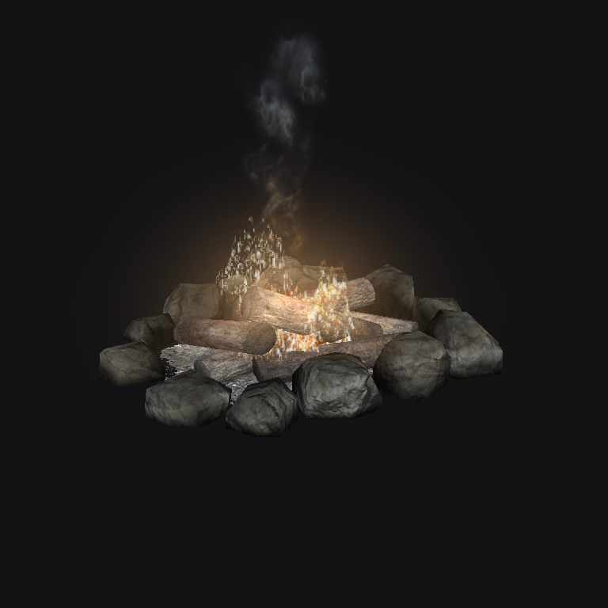
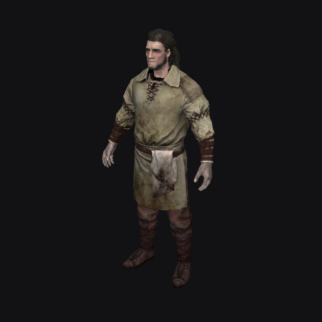
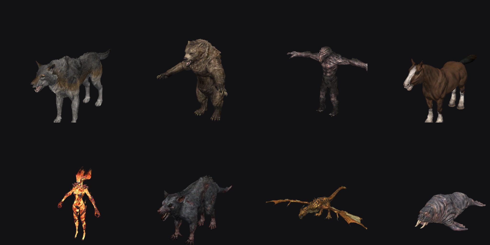

# Rendering

`Editor.Render/SceneRenderer.cs` + HLSL in `Shaders.cs`. Rendering approximates the game with
CK-style display modes; it is not an exact copy of the game's pipeline. Repository guidance:
[AGENTS.md](../AGENTS.md).

The render window separates editing tools from **Show**, **Display**, **Camera**, and **Preset**.
In narrow windows, camera/presets move into Display, and Havok/creation into Tools.
Counters, coordinates, and the detailed overlay are under **Display → Diagnostics**.
Switching layouts does not recreate the scene; `RenderWindow.Update` finishes background work even while hidden.
Toolbar sections and tools use `Ui/Studio.cs`; edges and selected docking tabs use
`Theme.Surfaces` for each palette. This is window chrome only: scene passes and editing state are shared.
When height/width is insufficient, the same commands collapse into **Tools / Display** instead of consuming
the entire scene area: otherwise the viewport stops drawing and its models cannot finish loading.
In the Records layout, Preview is a tab beside Inspector rather than a bottom dock; the renderer/mesh cache remains shared.

This describes version 0.77.0, including the workspace shell and Bepu update,
not verification of every game model.
Through [AI/MCP](AI-BRIDGE.md), compatible clients can access the same viewport/camera and add annotations;
the bridge does not add a game renderer and is not an SKSE live link.

## Frame

1. Frame constants: camera, sun/ambient from the cell's XCLL/LGTM, fog, up to 32 nearest point
   lights, camera axes (for billboards and particles), animation time.
2. Landscape: base layer + alpha layers per quadrant.
3. Opaque shapes: instanced (one draw per shape for all references of a model).
4. Water: planes.
5. Transparent shapes and particles: sorted back to front; parts of an object retain NIF order.
   Navmesh is drawn after the blended pass so mist cards do not cover its overlay.
   Normal mode respects depth; near/far copies are pulled slightly toward the camera, with the faint
   far copy revealing navmesh beneath low rubble/carpets. W modes: normal / on top / navmesh only.
6. Markers, selection outline, lines (light radius, cell boundaries), reference primitives (`DrawPrimitives`,
   with Markers only: alpha 0x22 fill + edges; rooms/portals/multibound/occlusion and the box around the camera use edges only).

Reversed-Z, infinite far plane; NIF triangles are CCW.

## Materials

- **BSLightingShaderProperty**: diffuse, tangent/model-space normals, specular, glow map,
  own emission, hair tint. Lambert + Blinn lighting, without shadows.
- **BSEffectShaderProperty** follows the game (checked against `Community Shaders/Shaders/Effect.hlsl`):
  - base color = emissive color × vertex color (RGB and alpha);
  - alpha = (texture alpha, or 1 for greyscale-to-alpha) × base-color alpha × material alpha;
  - **greyscale to palette alpha**: alpha = palette(u = texture alpha, v = alpha);
  - **greyscale to palette color**: color = emissive multiplier × palette(u = texture green, v = base-color red);
  - otherwise color = base color × emissive multiplier × texture.
  Palettes are two-dimensional (for example 512×128): dark/transparent rows at the top, bright rows at the bottom.
- Refraction (heat haze) is not drawn: its diffuse slot contains a normal map.
- NiAlphaProperty: blend factors from flags, alpha test with threshold.

## Shader animation

`BSEffectShaderPropertyFloatController` / `BSLightingShaderPropertyFloatController` → `NifFloatAnimation`:
U/V offset and scale (flowing water, flame-atlas frames), alpha, emissive multiplier. NiFloatData keys
are linear or stepped; quadratic and TBC keys are treated as linear. Timing follows NiTimeController
(frequency, phase, start/stop, loop / reverse / clamp). Color controllers and NiTransformController
are not played.

## Billboards

Shapes beneath `NiBillboardNode` retain the node's local coordinates (scale without rotation) around
its position. The vertex shader maps local X/Y to screen right/up and +Z toward the camera
(ALWAYS/RIGID_FACE_CAMERA/CENTER), or rotates around the node's up axis (ROTATE_ABOUT_UP).
Picking skips billboards; they do not contribute to drop-to-ground bounds or Preview framing.

## Particles

`NiParticleSystem` / `BSStripParticleSystem` are parsed into `NifParticleSystem` (`NifFile.Effects.cs`):

- box / sphere / cylinder / mesh / array emitters, speed, declination and angle with variation, radius, lifetime;
- `NiPSysEmitterCtlr`: birth rate (constant or keyed) and enabled state;
- gravity (planar / spherical), drag, grow/fade, `BSPSysScaleModifier`, `BSPSysSimpleColorModifier`,
  `NiPSysColorModifier`, rotation, atlas (`NiPSysData` sub-texture offsets, `BSPSysSubTexModifier`),
  aspect ratio and velocity alignment.

Not simulated: spawn-on-death, colliders, wind, fields, LOD modifier. Strips are drawn as ordinary quads.

CPU simulation runs in model space (`Particles.cs`) at 1/30 s steps; each model particle system has one
simulation shared by all references (all torches burn identically, reducing cost). New systems are
immediately warmed up over the particle lifetime. `VSParticle` turns quads toward the camera.
Particles beyond 9000 units are not simulated. **Display → Particles / Animations** disables particles / freezes time.

## NPCs and creatures

An actor (ACHR) is rendered as a composite of several NIFs (`ActorAppearance.cs`, cache key
`actor:a.nif|b.nif|…`):

1. NPC_ or LVLN base (first entry by level for LVLN); templates supply appearance under
   *Traits* and clothing under *Inventory*.
2. Race (and its ArmorRace) selects the appropriate ARMA for each armor; sex selects the male/female model.
3. Default outfit first (first leveled-list entry, or all with *Use All*), then skin
   (NPC worn armor or race skin) in unoccupied slots only. A skin part is hidden when its main
   slot is occupied: body slot (32), otherwise its lowest slot (a bare body disappears under a shirt,
   but a draugr body remains under a helmet alone).
4. Head: prebuilt FaceGen at `meshes\actors\character\facegendata\facegeom\<NPC plugin>\<local FormID:X8>.nif`
   (template FaceGen for NPCs inheriting Traits). Without the file, NPC/race head parts are used without morphs.
5. Scale = NPC height × race height × reference scale.

Skinning: SSE skinned-shape vertices are in `NiSkinPartition` (shared buffer; partition triangle indices
are already global), while LE uses shape data. Vertices are transformed to bind pose by linear blending:
bone node from the same NIF × bone skin transform from `NiSkinData`, with weights from `NiSkinData` or
partitions. Race skeletons and animations are not applied: actors remain in bind pose (arms slightly
outward), as in NifSkope.

Shaders: FaceGen heads use tint (slot 6) and detail (slot 3) with `GetFacegenBaseColor` from
Lighting.hlsl; hair uses `lerp(1, hair color, vertex green)`.

Not implemented: body skin tint, hiding hair beneath helmets, held weapons, poses/animations.

## Collision

`NifFile.Collision.cs` reads Havok into triangles and convex pieces. `MeshCache.CollisionLines` builds
edges for F4 (including thumbnail-model loading); `PhysicsDrop` builds dynamic bodies, and `NavmeshGeometry`
can use this geometry for generation. All three use pinned Bepu **2.5.0-beta.33**.
In 2.4, a numerical loop in `ConvexHullHelper.ReduceFace` overflowed an unmanaged list and crashed the process
with `0xc0000005`; [upstream #301](https://github.com/bepu/bepuphysics2/issues/301) describes the same mechanism.
The `SafePiece` thin-piece filter does not replace the traversal fix. `stbedit-cli collisiontest` checks
edge geometry and inertia, including a public numerically difficult point set; it writes nothing to game/mod folders.

## Current limitations

Shadows, reflections, parallax, snow, and distant LOD display are not implemented. Rendering does not
promise exact agreement with game lighting. Weather clouds, precipitation, and image space are not drawn.
The editor has no LOD generator; xLODGen / TexGen / DynDOLOD are external tools. Generating LOD and
displaying it in the viewport are separate capabilities.
